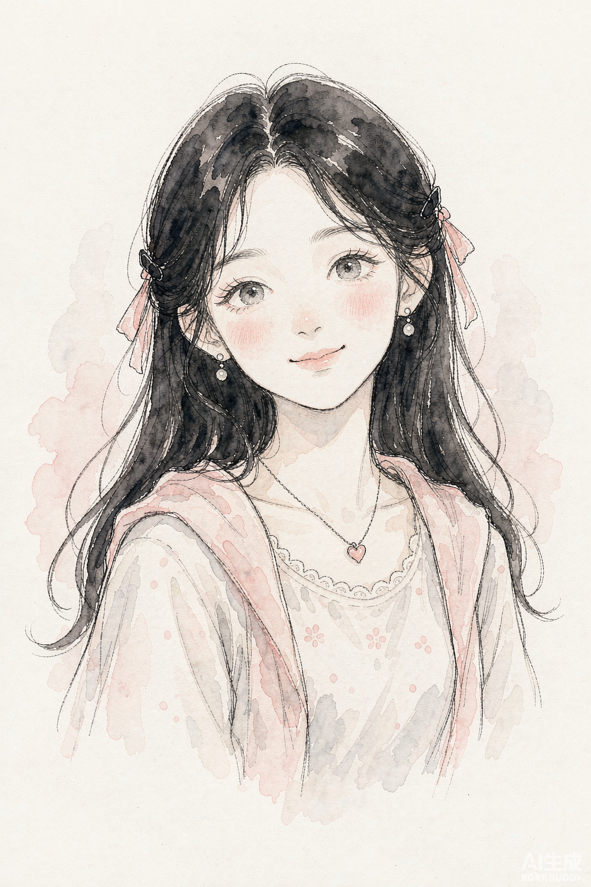
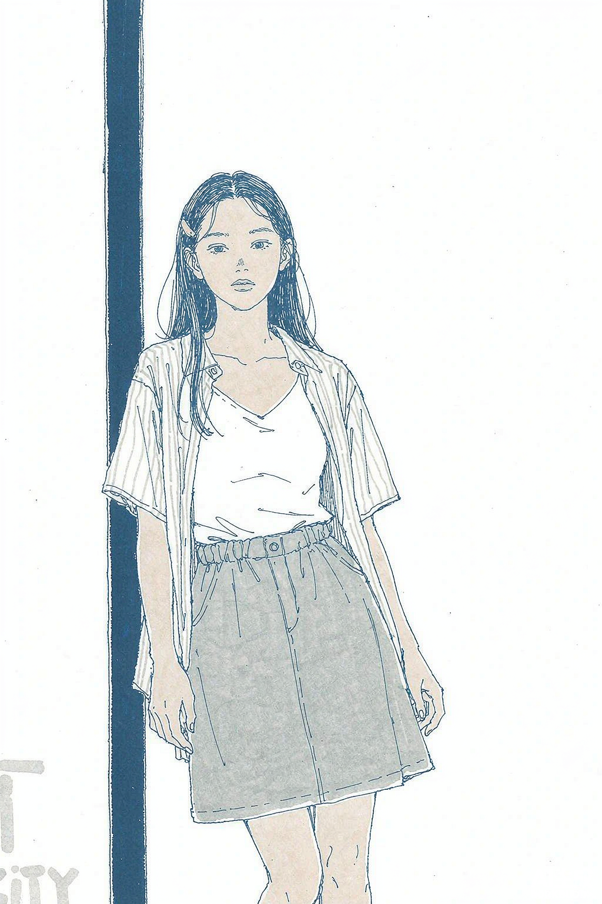
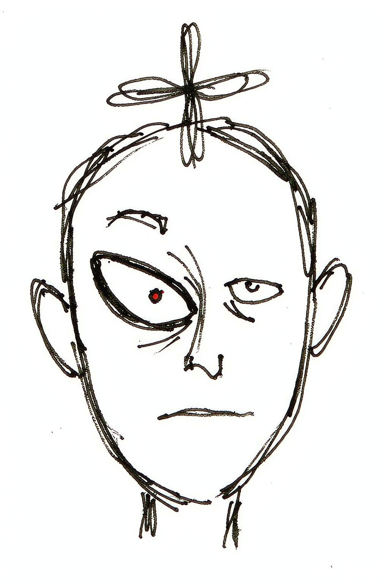
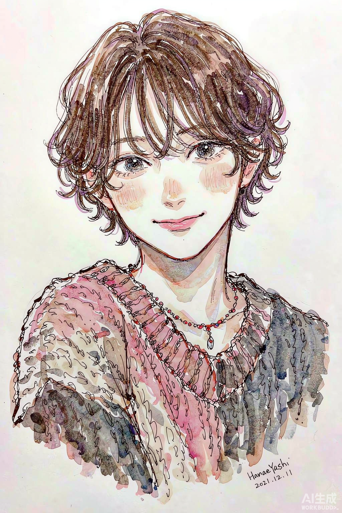

# 夜秣个人IP生成器（手绘个人IP生成）

> 选一种手绘风格，传一张照片，出一张**专属你的手绘个人 IP 形象图**——认得出是你，又比你好看出一截。

   

## ⚠️ 购买前必读

| 事项 | 说明 |
|---|---|
| 💰 计费方式 | **5.00 元 / 次**，支付宝「AI 付」按次结算 |
| 💳 支付渠道 | **仅支持支付宝**。首次使用需在支付宝开通一次「AI 付」钱包授权，之后自动扣款 |
| 🌏 网络限制 | **服务端位于中国大陆，海外网络环境无法使用** |
| 📦 本仓库是什么 | 技能客户端——负责连接服务端获取支付宝付款码、提交凭证取货；**形象图生成全部在服务端完成** |

## 🌟 核心优势

| 生成卡通形象的塌方点 | 夜秣个人IP生成器怎么接住 |
|---|---|
| 千人一面的模板脸，完全不像本人 | **照片身份融合**：服务端结合照片身份生成，五官气质认得出是你 |
| 风格单一，选来选去就那两三种 | **15 种精选手绘风格**，总有一款贴你人设 |
| 出图当头像糊、当封面不够大 | 服务端出品高清单图，头像 / 封面 / 贴纸都能用 |
| 付了钱怕不出图 | **订单幂等**：同单重试不重复扣费，凭证在就能取货 |

> 一句话：**不是给你"滤镜一下"，而是给你"长出第二个自己"——能当头像、能当 IP、能当招牌。**

## 💡 工作原理（三步走）

```
1. quote  → 客户端连服务端，拿到本单报价与支付宝付款码
2. pay    → 支付宝扫码付款
3. prove  → 凭付款凭证取货，服务端交付专属 IP 形象图
```

## 🚀 安装

**SkillHub 一键装（推荐）**：WorkBuddy 技能市场搜 `yemo-ip`，或直接下载：

```
https://api.skillhub.cn/api/v1/download?slug=yemo-ip
```

**手动安装**：

```bash
git clone https://github.com/mcm369568095-hash/yemo-ip.git
```

**怎么触发**：对 WorkBuddy 说「做个个人IP」「生成我的卡通形象」「上传照片出IP」。

## 🎨 15 种手绘风格（完整清单）

选风格时只要把**编号**告诉技能即可（如「用 021 风格」）。15 种全部经筛选，适合「保留真人身份 + 手绘化」的个人 IP 生成：

### 风格样图（AI 生成示例，展示不同气质）

| 可爱治愈（021/023/039） | 都市冷淡（003/015/030） |
|---|---|
|  |  |
| 夸张个性（001/009/034/051） | 水彩通透（021/036/039） |
|---|---|
|  |  |

### 完整 15 种手绘风格清单

| 编号 | 生图名称 | 核心视觉特征 | 分组 |
|---|---|---|---|
| 001 | Playful Deadpan Doodle | 松散黑线、怪萌人物、少量点色、白底、日常吐槽与尴尬幽默；脸型、头身比例与手脚形状形成清楚独立的视觉语言；表情偏冷脸、尴尬… | A · 国际社论漫画 / 幽默手绘 |
| 003 | Fine-Line Urban Miniature | 极细钢笔线、小人物大空间、大量留白、温柔法式都市幽默。 | A · 国际社论漫画 / 幽默手绘 |
| 005 | Childlike Free-Line Humor | 极简黑线、儿童式自由造型、荒诞动作、低细节。 | A · 国际社论漫画 / 幽默手绘 |
| 009 | Raw Zine Diary Cartoon | 粗糙手帐、Zine 感、手写字、原始情绪、反精致；保留纸纹、颗粒、套印或手工媒介的不完美。 | A · 国际社论漫画 / 幽默手绘 |
| 015 | Soft Relationship Editorial Line Art | 极简人物线稿、人与关系、柔和色块、生活型社论；配色控制柔和低刺激色域，少量点色，背景轻干净。 | A · 国际社论漫画 / 幽默手绘 |
| 018 | Minimal Deadpan Dialogue | 极简圆头人物、面无表情、简单动物、灰蓝与米色小色块；干净轮廓置于白底，冷淡姿态制造荒诞幽默。 | A · 国际社论漫画 / 幽默手绘 |
| 021 | Watercolor Handwritten Life Notes | 极简女性人物、细黑线、细长四肢、柔和水彩点染；单一物件承载情绪，白底留白与轻微纸张质感。 | B · 国际绘本 / 叙事型手绘 |
| 023 | Warm Minimal Female Line | 黑色简线、黑色长发女性、坐姿、白上衣与蓝色牛仔裤；少量暖色腮红和红色鞋带点亮画面，背景干净，亲密松弛。 | B · 国际绘本 / 叙事型手绘 |
| 028 | Retro Detached American Comic | 黑色齐肩直发、方形眼镜、条纹上衣与绿色外套、冷静平涂色块；正面站立、表情疏离，复古美式成人漫画克制感。 | B · 国际绘本 / 叙事型手绘 |
| 030 | Clean Urban Solitude Comic | 清晰细线、年轻亚洲女性半身像、深色外套、低饱和肤色与黑发；侧身回望、安静克制，留白都市观察。 | B · 国际绘本 / 叙事型手绘 |
| 034 | Elastic Sunday Strip | 松散弹性墨线、夸张儿童表情、强肢体动作、少量透明水彩；保留手绘笔压、停顿与轻微不齐整，纸纹与透明叠染。 | B · 国际绘本 / 叙事型手绘 |
| 036 | Loose Ink-and-Wash Storybook | 抖动墨线、松散水彩、四肢夸张、动作极灵、快速速写感。 | B · 国际绘本 / 叙事型手绘 |
| 039 | Warm Vintage Line-and-Wash | 古典细线、水彩旧书感、安静角色、温暖生活气息。 | B · 国际绘本 / 叙事型手绘 |
| 049 | Dreamlike Surreal Storybook | 柔和手绘笔触、轻微超现实人物、低饱和梦境配色、安静叙事气质；比例略诗意变形，表情克制沉静，留白空间感。 | B · 国际绘本 / 叙事型手绘 |
| 051 | Expressive Character Sketch | 速写式手绘线条、夸张但亲切的人物表演、清楚外轮廓与鲜明性格；脸部简化、眉眼嘴主导情绪，动画草图弹性。 | B · 国际绘本 / 叙事型手绘 |

> 想要**可爱治愈**选 021/023/039；**都市冷淡/文艺**选 003/015/030；**夸张个性/有梗**选 001/009/034/051；**水彩通透**选 021/036/039；**复古美式**选 028/034。

## 📜 版权

本仓库内容版权归 **夜秣** 所有，仅供安装与个人使用，**禁止倒卖、二次分发或去除付费逻辑**。

## 📮 关注公众号「夜秣AI搞钱」


> 更多 AI 实战技能与拆解，微信搜一搜「夜秣AI搞钱」。
